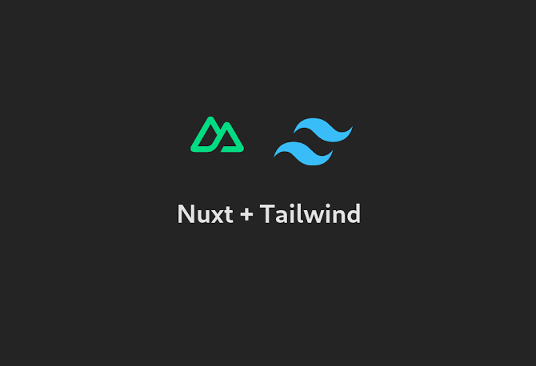

# WEB LA MANUELA
 


Look at the [Nuxt documentation](https://nuxt.com/docs/getting-started/introduction) to learn more.

## <span style="color: orange;" >Publicar tu proyecto La Manuela  , desarrollado con Nuxt, TypeScript y Tailwind CSS <span style="color: orange;" >


 
## <span style="color: orange;" >  En GitHub Pages.</span  >


 

> ## Setup


1. Actualiza <mark>nuxt.config.ts</mark> 
Mantén tu configuración y asegúrate de conservar baseURL para que las rutas y los recursos funcionen al publicar el proyecto.


```ts

import tailwindcss from "@tailwindcss/vite";

export default defineNuxtConfig({
  compatibilityDate: "2025-07-15",

  devtools: {
    enabled: false,
  },

  css: ["~/assets/css/main.css"],

  vite: {
    plugins: [tailwindcss()],
  },

  app: {
    baseURL: process.env.NUXT_APP_BASE_URL || "/",

    head: {
      title: "La Manuela | Café-Bar",
      meta: [
        {
          name: "description",
          content:
            "Disfruta del mejor café, tapas y buenos momentos en La Manuela Café-Bar.",
        },
      ],
    },
  },
}
)
;

 ```


> He ajustado la descripción para que coincida con el nombre de tu negocio.


2. Crea el archivo en la ruta<mark>  .github/workflows/deploy.yml</mark>  en la carpeta raiz de tu proyecto y pega este código:


> Aquí tienes el archivo completo .github/workflows/deploy.yml  
```yaml

name: Deploy La Manuela to GitHub Pages

on:
  push:
    branches:
      - main
  workflow_dispatch:

permissions:
  contents: read

concurrency:
  group: github-pages
  cancel-in-progress: true

jobs:
  build:
    name: Build Nuxt
    runs-on: ubuntu-latest

    steps:
      - name: Checkout repository
        uses: actions/checkout@v4

      - name: Setup Node.js
        uses: actions/setup-node@v4
        with:
          node-version: 22
          cache: npm

      - name: Install dependencies
        run: npm ci

      - name: Generate static website
        run: npx nuxt build --preset github_pages
        env:
          NUXT_APP_BASE_URL: /${{ github.event.repository.name }}/

      - name: Upload GitHub Pages artifact
        uses: actions/upload-pages-artifact@v3
        with:
          path: .output/public

  deploy:
    name: Deploy to GitHub Pages
    needs: build
    runs-on: ubuntu-latest

    permissions:
      pages: write
      id-token: write

    environment:
      name: github-pages
      url: ${{ steps.deployment.outputs.page_url }}

    steps:
      - name: Deploy website
        id: deployment
        uses: actions/deploy-pages@v4

```

Guarda los archivos y sube los cambios:

3. Sube el proyecto a GitHub
 

> ###  Crea un repositorio en GitHub  con el nombre: <mark> LaManuela </mark>

Desde la terminal, dentro de la carpeta de tu proyecto, ejecuta:


```bash
git init
git add .
git commit -m "Primera versión de la web"
git branch -M main
git remote add origin https://github.com/TU-USUARIO/LaManuela.git
git push -u origin main

```

3. Publicar el proyecto
 

 


```bash
git add .
git commit -m "Preparar despliegue de La Manuela"
git push origin main
```
 


1. Entra en Settings → Pages de tu repositorio .

2. En Build and deployment → Source, selecciona GitHub Actions. 

3. Abre la pestaña Actions y comprueba que ambos trabajos, Build Nuxt y Deploy to GitHub Pages, finalicen correctamente.


## Pasos para publicar los cambios
Guarda los archivos y sube los cambios:


```bash
git add . 
git commit -m "Cambios realizados"
git push origin main

```
 Abre la pestaña Actions y comprueba que ambos trabajos, Build Nuxt y Deploy to GitHub Pages, finalicen correctamente


 

 

Check out the [deployment documentation](https://nuxt.com/docs/getting-started/deployment) for more information.
